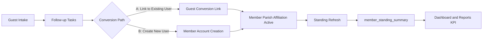
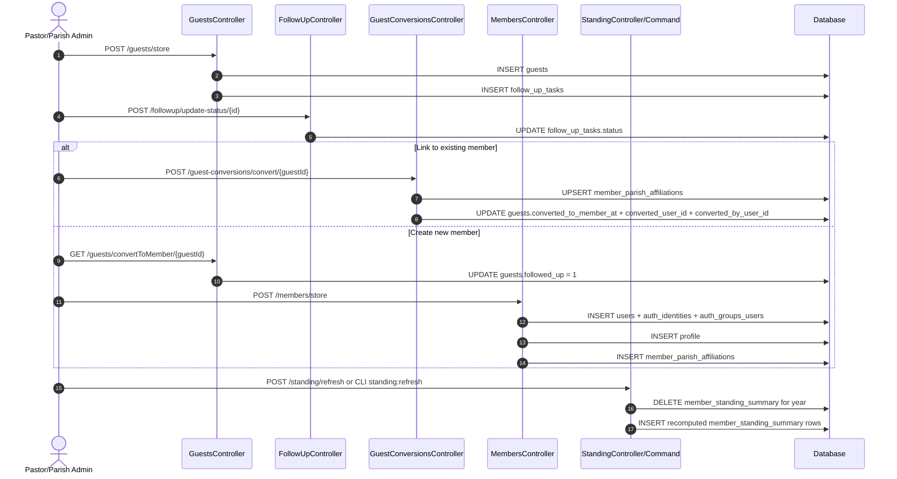
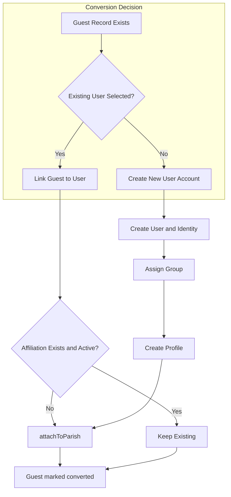
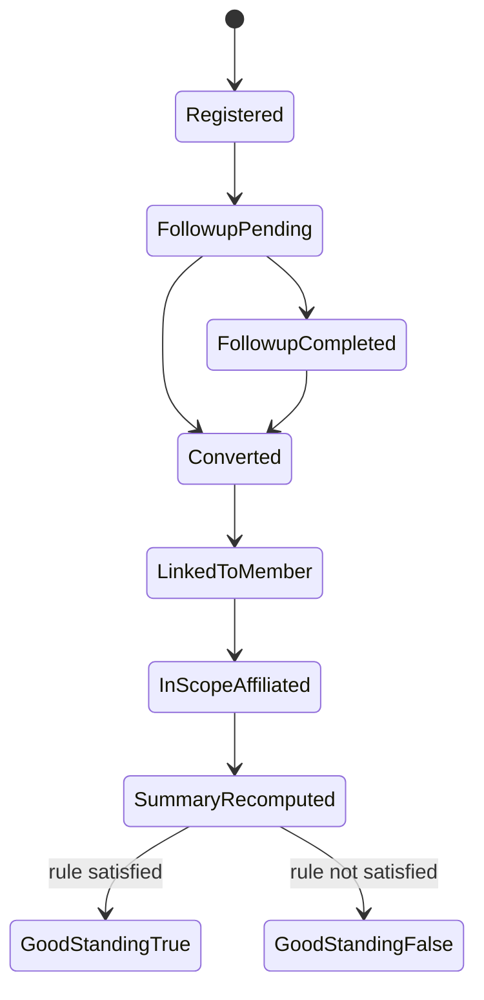
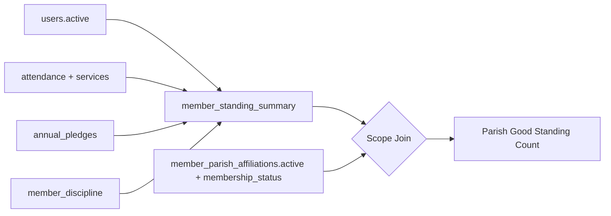
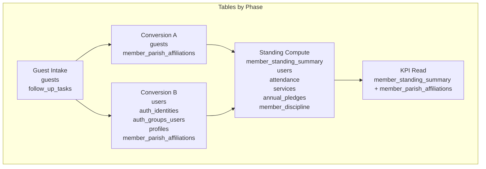
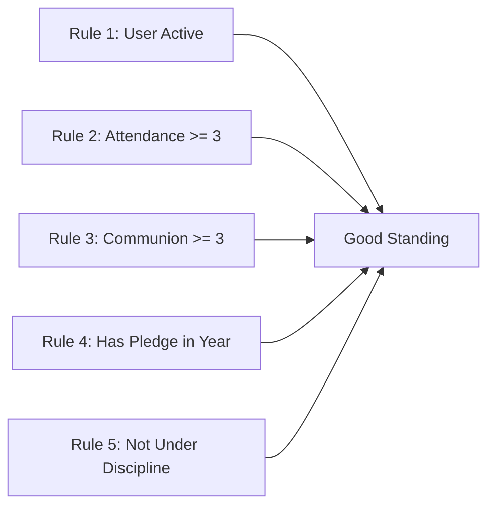
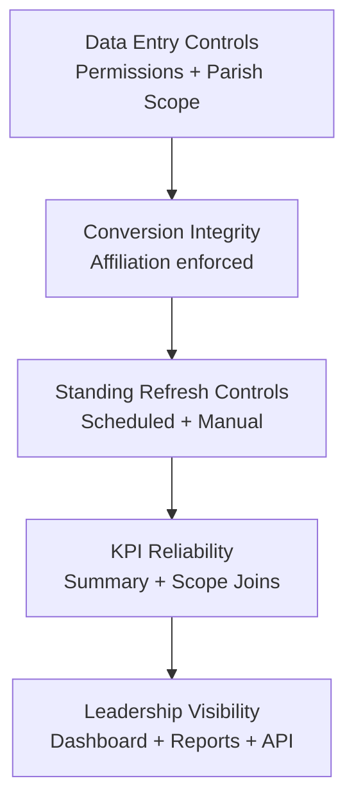

> **SUPERSEDED** — This document describes the retired guest-table era. The canonical lifecycle is `parish_affiliation.membership_status` (`visitor → regular_attender → member`); see `docs/VISITOR_LIFECYCLE.md` and `docs/FOLLOWUP_WORKFLOW_SYSTEM.md`.
>
> ---
>
# Guest Registration to Good Standing - Diagram Pack (2026-04-11)

