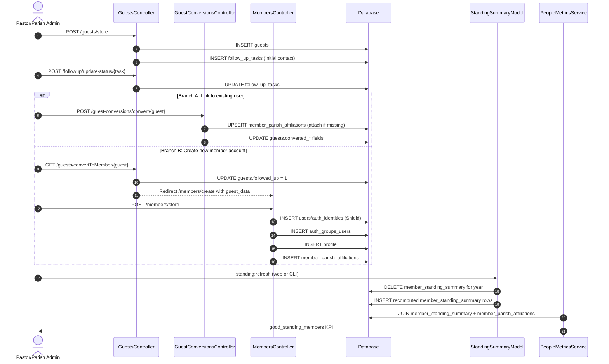

# Guest Registration to Good Standing Flow Report (2026-04-11)

## Objective

Document the end-to-end operational flow from guest intake through guest conversion and into parish member good-standing status, including:

- Controller and route entry points
- Table-level writes and reads per phase
- Status transitions
- Good-standing computation inputs and outputs
- Verification queries for production/staging audits

## Scope and Assumptions

- Scope is parish-level operational flow (pastor/parish-admin/member-portal interfaces).
- Good standing source of truth is member_standing_summary.
- Parish scoping for standing is enforced through member_parish_affiliations joins (member_standing_summary is user/year scoped, not parish scoped).
- Two conversion branches are supported:
  - Branch A: link guest to an existing user/member account.
  - Branch B: move guest into member account creation flow (prefilled handoff).

## Entry Points (Routes and Controllers)

### Guest Intake and Follow-up

- GET /guests, GET /guests/create, POST /guests/store, GET /guests/view/{id}, POST /guests/update/{id}
  - Pastor/Controllers/Guests::index/create/store/view/update
- POST /followup/store, POST /followup/update-status/{id}
  - Pastor/Controllers/FollowUp::store/updateStatus

### Guest Conversion

- GET /guests/convertToMember/{id}
  - Pastor/Controllers/Guests::convertToMember
  - Marks follow-up and hands off to member create form.
- GET /guest-conversions, POST /guest-conversions/convert/{guestId}, POST /guest-conversions/revert/{guestId}
  - MemberPortal/Controllers/GuestConversions::index/convert/revert

### Member Good Standing

- POST /standing/refresh
  - MemberPortal/Controllers/Standing::refresh
  - App/Commands/RefreshGoodStanding (CLI equivalent: standing:refresh)
- GET /standing, GET /standing/api/summary
  - MemberPortal/Controllers/Standing::index/summaryApi
- Dashboard KPI read path
  - App/Libraries/PeopleMetricsService::getParishSummary

## End-to-End Flow



## Phase-by-Phase Table Involvement

| Phase | Primary Writes | Primary Reads | Core Keys / Filters |
| --- | --- | --- | --- |
| Guest intake | guests, follow_up_tasks | parishes, users (assignee), profile (assignee names) | guests.parish_id, follow_up_tasks.guest_id |
| Guest follow-up | follow_up_tasks (status/notes), guests.followed_up (optional via guest edit) | guests, follow_up_tasks, profile | follow_up_tasks.status, guests.followed_up |
| Conversion A (existing user link) | guests.converted_to_member_at, guests.converted_user_id, guests.converted_by_user_id; member_parish_affiliations (attach/reactivate) | guests, member_parish_affiliations | guests.id, guests.parish_id, mca.user_id+parish_id |
| Conversion B (new account) | users, auth_identities, auth_groups_users, profile, member_parish_affiliations | parishes (for hierarchy), existing identities (uniqueness checks) | users.id, profile.user_id, mca.user_id+parish_id |
| Standing recompute | member_standing_summary (year snapshot rebuild) | users, attendance, services, annual_pledges, member_discipline | mss.user_id+year, services.date range, pledges year |
| Standing display/API | none | member_standing_summary joined with member_parish_affiliations (+parish/diocese/province scope joins) | mss.year, mss.is_good_standing, mca.active, mca.membership_status |

## Status and State Transitions

### Guest Lifecycle (guests)

- Initial record on intake:
  - followed_up = 0
  - converted_to_member_at = NULL
  - converted_user_id = NULL
- Follow-up progression:
  - follow_up_tasks.status transitions pending -> completed
  - guests.followed_up can be set to 1
- Conversion completion:
  - converted_to_member_at set to timestamp
  - converted_user_id set to users.id
  - converted_by_user_id set to actor users.id

### Member Affiliation Lifecycle (member_parish_affiliations)

- attachToParish guarantees one affiliation per user/parish key.
- Conversion to member in parish scope requires active affiliation:
  - active = 1
  - membership_status typically active
  - is_home set according to path (new member creation sets true in current flow)

### Good Standing Lifecycle (member_standing_summary)

Row identity:

- Unique per (user_id, year)

Computed flags:

- is_active_member from users.active
- attendance_count and communion_count from attendance joined to services within year window
- has_pledged from annual_pledges for same year (excluding cancelled)
- is_under_discipline from member_discipline overlap with year window
- is_good_standing computed as all conditions true

## Good Standing Rule (Current Runtime Logic)

A user is in good standing for year Y when:

- user is active
- attendance_count >= 3
- communion_count >= 3
- has_pledged = true for Y
- is_under_discipline = false during Y window

Formally:

- is_good_standing = is_active_member AND attendance_count >= 3 AND communion_count >= 3 AND has_pledged AND NOT is_under_discipline

## Data Model Notes (Important)

- member_standing_summary has no parish_id.
- Parish-level good-standing outputs are derived by joining summary rows to member_parish_affiliations for active parish membership.
- Conversion writes do not directly write member_standing_summary; summary is refreshed by:
  - standing:refresh yearly recompute, and
  - per-user sync when users.active changes (UserModel hook to updateSingleUserStanding).

## Verification SQL Appendix

### A. Guest Intake and Conversion Integrity

```sql
-- 1) Guests converted without linked user (should be zero)
SELECT id, parish_id, converted_to_member_at, converted_user_id
FROM guests
WHERE converted_to_member_at IS NOT NULL
  AND converted_user_id IS NULL;
```

```sql
-- 2) Converted users without active parish affiliation in guest parish (should be zero)
SELECT g.id AS guest_id, g.parish_id, g.converted_user_id
FROM guests g
LEFT JOIN member_parish_affiliations mca
  ON mca.user_id = g.converted_user_id
 AND mca.parish_id = g.parish_id
 AND mca.active = 1
WHERE g.converted_to_member_at IS NOT NULL
  AND g.converted_user_id IS NOT NULL
  AND mca.id IS NULL;
```

```sql
-- 3) Unfollowed guests with all tasks completed (operational cleanup candidates)
SELECT g.id, g.first_name, g.last_name, g.followed_up
FROM guests g
WHERE g.followed_up = 0
  AND NOT EXISTS (
      SELECT 1
      FROM follow_up_tasks ft
      WHERE ft.guest_id = g.id
        AND ft.status = 'pending'
  );
```

### B. Good Standing Integrity

```sql
-- 4) Duplicate summary rows (must be zero)
SELECT user_id, year, COUNT(*) AS cnt
FROM member_standing_summary
GROUP BY user_id, year
HAVING COUNT(*) > 1;
```

```sql
-- 5) Parish-scoped good standing count (authoritative pattern)
-- Replace :parish_id and :year
SELECT COUNT(*) AS good_standing_count
FROM member_standing_summary mss
JOIN member_parish_affiliations mca
  ON mca.user_id = mss.user_id
 AND mca.parish_id = :parish_id
 AND mca.active = 1
 AND mca.membership_status = 'active'
WHERE mss.year = :year
  AND mss.is_good_standing = 1;
```

```sql
-- 6) Members marked good standing while user inactive (should be zero)
SELECT mss.user_id, mss.year, mss.is_good_standing, u.active
FROM member_standing_summary mss
JOIN users u ON u.id = mss.user_id
WHERE mss.year = :year
  AND mss.is_good_standing = 1
  AND u.active <> 1;
```

## Operational Risks and Controls

- Risk: guest converted_user_id points to a user not affiliated to guest parish.
  - Control: conversion path enforces attachToParish when needed.
- Risk: standing KPI appears stale after membership/pledge/attendance changes.
  - Control: run standing:refresh for target year as part of reconciliation window.
- Risk: affiliation status drifts to inactive while guest remains marked converted.
  - Control: periodic query #2 and admin remediation workflow.

## Files Reviewed

- Pastor/Config/Routes.php
- MemberPortal/Config/Routes.php
- Pastor/Controllers/Guests.php
- MemberPortal/Controllers/GuestConversions.php
- Pastor/Controllers/Members.php
- MemberPortal/Controllers/Standing.php
- app/Libraries/PeopleMetricsService.php
- app/Models/GuestModel.php
- app/Models/MemberParishAffiliationModel.php
- app/Models/MemberStandingSummaryModel.php
- app/Models/UserModel.php
- app/Commands/RefreshGoodStanding.php
- app/Database/Migrations/2025_01_01_000007_CreateGuests.php
- app/Database/Migrations/2026_03_26_000001_AddGuestConversionFields.php
- app/Database/Migrations/2025_01_01_000008_CreateFollowUpTasks.php
- app/Database/Migrations/2025_01_01_000002_CreateProfiles.php
- app/Database/Migrations/2026_03_18_000005_CreateMemberParishAffiliations.php
- app/Database/Migrations/2025_01_01_000005_CreateServices.php
- app/Database/Migrations/2025_01_01_000006_CreateAttendance.php
- app/Database/Migrations/2026_03_26_000002_CreateAnnualPledges.php
- app/Database/Migrations/2026_04_10_000001_CreateMemberDiscipline.php
- app/Database/Migrations/2026_04_10_000002_CreateMemberStandingSummary.php
