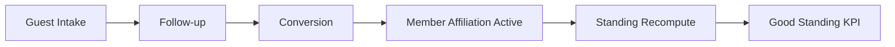
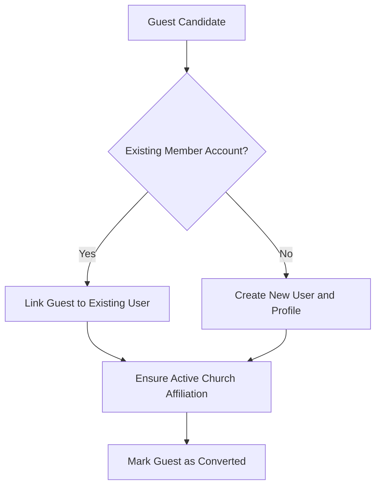
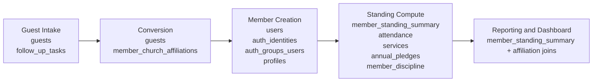
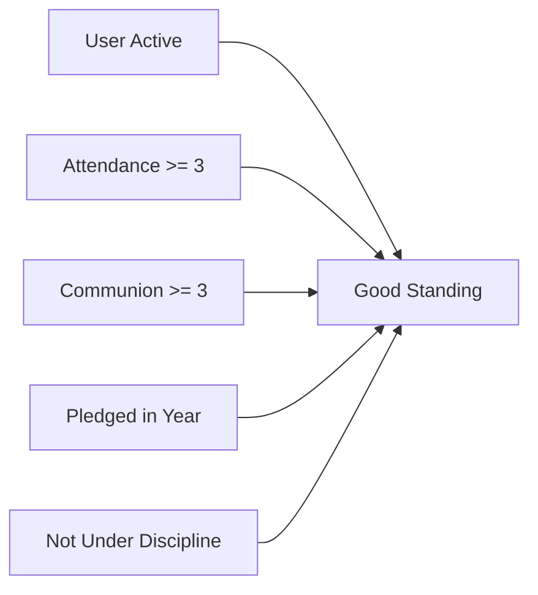
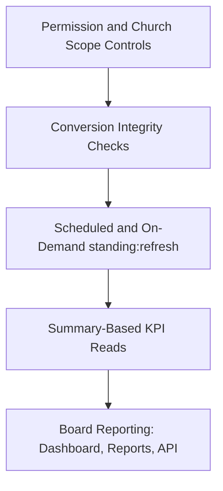

# Board Deck: Guest to Good Standing (5 Slides)

## Slide 1 - Executive Lifecycle

## Slide 2 - Conversion Decision Paths

## Slide 3 - Data Tables by Phase

## Slide 4 - Good Standing Rule

## Slide 5 - Governance and KPI Assurance

