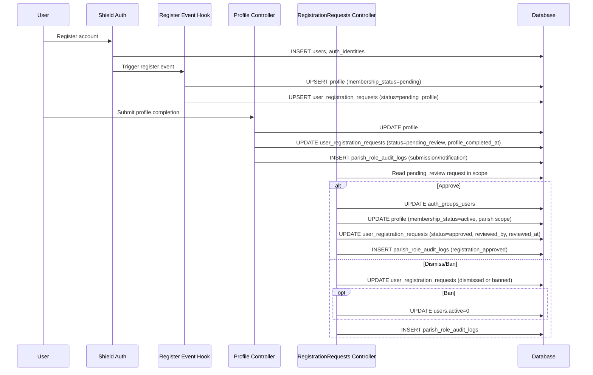
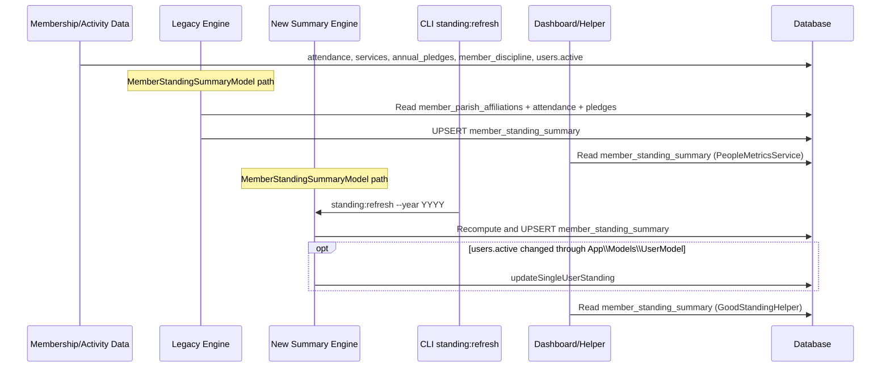

# Registration to Good Standing Flow Report (2026-04-10)

## Purpose

This report documents the implemented end-to-end lifecycle from user registration to good-standing outcomes, including the primary write/read tables and status transitions.

## Scope

- Authentication and initial onboarding record creation.
- Profile completion and moderation handoff.
- Parish-admin moderation and activation.
- Good-standing computation sources and refresh paths.

## Flow Overview

1. User registration creates authentication account records.
2. Registration event hook creates onboarding profile/request records.
3. User completes profile and submits parish selection for review.
4. Parish admin approves, dismisses, or bans the request.
5. Member activity data accumulates (attendance, communion, pledges, discipline).
6. Good-standing is computed and surfaced by standing services/dashboard metrics.

## Sequence Diagrams

### Onboarding and Moderation Sequence



### Standing Computation Sequence



## Detailed Step-by-Step Flow

### Step 1: Shield registration

Primary implementation:

- app/Config/Auth.php
- app/Config/Events.php (register event listener)

At registration time, Shield persists core auth identity records, then the register event listener enriches onboarding context.

Primary tables touched:

- users (new user account)
- auth_identities (email identity)
- auth_groups_users (role/group assignment defaults, depending on setup)

### Step 2: Onboarding bootstrap after register event

Primary implementation:

- app/Config/Events.php (Events::on('register', ...))

Behavior:

- Resolves province/diocese from selected parish when available.
- Ensures a profile row exists with membership_status set to pending.
- Creates or updates one user_registration_requests row with status pending_profile.

Primary tables written:

- profile
- user_registration_requests

Primary status after this step:

- user_registration_requests.status = pending_profile
- profile.membership_status = pending

### Step 3: Profile completion and submission for review

Primary implementation:

- MemberPortal/Controllers/Profile.php (complete and completeSubmit)

Behavior:

- Validates province, diocese, and parish hierarchy integrity.
- Updates profile demographics and geo context.
- Promotes registration request from pending_profile to pending_review.
- Sets profile_completed_at timestamp.
- Logs registration audit and notifies parish admins.

Primary tables written:

- profile
- user_registration_requests
- parish_role_audit_logs

Primary status after this step:

- user_registration_requests.status = pending_review

### Step 4: Moderation by parish admin

Primary implementation:

- Diocesan/Controllers/RegistrationRequests.php

Approval path behavior:

- Confirms request is still pending_review and in moderator scope.
- Assigns group role in auth_groups_users.
- Updates profile membership_status to active and sets province/diocese/parish scope.
- Marks request approved with reviewer metadata.

Dismiss/Ban behavior:

- Updates request status to dismissed or banned.
- Ban path deactivates users.active to 0.

Primary tables written:

- auth_groups_users
- profile
- user_registration_requests
- users (ban path active toggle)
- parish_role_audit_logs

Primary status after approval:

- user_registration_requests.status = approved
- profile.membership_status = active

## Good Standing Data Inputs

Good standing is derived from member lifecycle and contribution/discipline evidence.

Primary input tables:

- users (active flag)
- member_parish_affiliations (active membership and status for legacy review model)
- attendance
- services
- annual_pledges
- member_discipline

Supporting membership context tables:

- profile
- parishes
- dioceses
- provinces

## Good Standing Computation Paths

The codebase currently contains two computation paths.

### Path A: Legacy review model (actively used by parish dashboard people metrics)

Primary implementation:

- app/Models/MemberStandingSummaryModel.php
- app/Libraries/PeopleMetricsService.php

Rules (legacy review):

- Active parish affiliation exists.
- Affiliation membership_status is active.
- Communion count for year >= 3.
- Pledge exists for current year.
- Pledge exists for previous year.

Primary output table:

- member_standing_summary

### Path B: Summary snapshot model (newer scheduled/summary implementation)

Primary implementation:

- app/Models/MemberStandingSummaryModel.php
- app/Commands/RefreshGoodStanding.php
- app/Models/UserModel.php (active-change sync)
- app/Helpers/GoodStandingHelper.php

Rules (summary model):

- users.active = 1
- attendance_count >= 3
- communion_count >= 3
- has_pledged = true (current year, non-cancelled)
- is_under_discipline = false for overlapping period

Primary output table:

- member_standing_summary

Refresh and sync behavior:

- Batch yearly refresh: php spark standing:refresh --year YYYY
- Immediate per-user sync when users.active changes through app UserModel update path.

## Registration Status State Machine

Source model:

- app/Models/UserRegistrationRequestModel.php

Statuses:

- pending_profile: registered, must complete onboarding profile.
- pending_review: submitted for parish-admin moderation.
- approved: accepted and role/scopes applied.
- dismissed: rejected.
- banned: rejected and account deactivated.

Gate enforcement:

- app/Filters/RegistrationGateFilter.php
- pending_profile forced to /profile/complete.
- dismissed/banned are logged out.
- pending_review and approved can proceed to controller-level handling.

## Table Involvement Matrix

| Phase | Primary Writes | Primary Reads |
| --- | --- | --- |
| Register | users, auth_identities, profile, user_registration_requests | parishes, dioceses, provinces |
| Complete Profile | profile, user_registration_requests, parish_role_audit_logs | provinces, dioceses, parishes |
| Moderate Request | auth_groups_users, profile, user_registration_requests, users, parish_role_audit_logs | user_registration_requests, profile |
| Standing Refresh (summary) | member_standing_summary | users, attendance, services, annual_pledges, member_discipline |

## Current Operational Notes

1. Approval updates profile membership status and role assignment, but does not directly call MemberParishAffiliationModel::attachToParish in RegistrationRequests approve flow.
2. Parish dashboard people metrics currently reads good-standing counts from member_standing_summary via PeopleMetricsService.
3. The newer member_standing_summary path is implemented and refreshable via standing:refresh, with helper support for summary counts.

## Verification SQL Appendix

Run these checks after deployment or cutover to verify correctness.

### A. Registration pipeline consistency

```sql
-- 1) One request row per user
SELECT user_id, COUNT(*) AS cnt
FROM user_registration_requests
GROUP BY user_id
HAVING COUNT(*) > 1;
```

```sql
-- 2) Approved request should usually have active profile membership
SELECT urr.user_id, urr.status, p.membership_status
FROM user_registration_requests urr
LEFT JOIN profile p ON p.user_id = urr.user_id
WHERE urr.status = 'approved'
    AND (p.user_id IS NULL OR p.membership_status <> 'active');
```

```sql
-- 3) Banned request should have users.active = 0
SELECT urr.user_id, urr.status, u.active
FROM user_registration_requests urr
JOIN users u ON u.id = urr.user_id
WHERE urr.status = 'banned'
    AND u.active <> 0;
```

### B. Standing summary integrity

```sql
-- 4) Enforce uniqueness expectation for summary snapshots
SELECT user_id, year, COUNT(*) AS cnt
FROM member_standing_summary
GROUP BY user_id, year
HAVING COUNT(*) > 1;
```

```sql
-- 5) Freshness check for current year snapshots
SELECT YEAR(CURDATE()) AS expected_year,
             COUNT(*) AS rows_for_current_year,
             MIN(last_updated) AS oldest_last_updated,
             MAX(last_updated) AS newest_last_updated
FROM member_standing_summary
WHERE year = YEAR(CURDATE());
```

```sql
-- 6) Rows marked good standing while inactive in users (should be zero)
SELECT mss.user_id, mss.year, mss.is_good_standing, u.active
FROM member_standing_summary mss
JOIN users u ON u.id = mss.user_id
WHERE mss.year = YEAR(CURDATE())
    AND mss.is_good_standing = 1
    AND u.active <> 1;
```

### C. Summary consistency checks

```sql
-- 7) Validate parish-scoped good-standing count from summary
-- Replace :parish_id and :year as needed.
SELECT COUNT(*) AS summary_good
FROM member_standing_summary mss
JOIN member_parish_affiliations mca
    ON mca.user_id = mss.user_id
   AND mca.parish_id = :parish_id
   AND mca.active = 1
WHERE mss.year = :year
  AND mss.is_good_standing = 1;
```

```sql
-- 8) User-level summary sanity sample for a parish/year
-- Replace :parish_id and :year as needed.
SELECT
    mca.user_id,
    mss.is_active_member,
    mss.attendance_count,
    mss.communion_count,
    mss.has_pledged,
    mss.is_under_discipline,
    mss.is_good_standing
FROM member_parish_affiliations mca
JOIN member_standing_summary mss
    ON mss.user_id = mca.user_id
   AND mss.year = :year
WHERE mca.parish_id = :parish_id
  AND mca.active = 1
ORDER BY mca.user_id
LIMIT 200;
```

## Unification Recommendation (Concrete Cutover Plan)

## Single Source of Truth Decision

Decision:

- member_standing_summary is the authoritative source of truth for good-standing outputs across all runtime surfaces.

Surface policy matrix:

| Surface | Source of Truth | Notes |
| --- | --- | --- |
| Dashboard KPI cards/widgets | member_standing_summary | Includes parish/diocese/province rollups via scope joins. |
| Reports (CSV/PDF/on-screen) | member_standing_summary | Use summary-only counts and scope joins. |
| API responses for standing counts/lists | member_standing_summary | API contracts should not expose mixed-source counts. |

Non-authoritative path policy:

- No legacy standing read path is authoritative for runtime decisions after cutover.
- Legacy standing artifacts are decommissioned from runtime and retained only in historical documentation/migrations.

### Decision

Adopt member_standing_summary as the single source of truth for runtime good-standing counts and KPI surfaces.

Rationale:

- It already supports scheduled full-year recompute and per-user active-change sync.
- It includes discipline windows directly, which legacy path does not model.
- It is purpose-built for snapshot and fast aggregate reads.

### Cutover target

- Runtime dashboards and metrics: member_standing_summary only.
- Legacy standing table/model removed from runtime code and schema via retirement migration.

### Phased cutover

1. Phase 0 - Stabilize inputs

- Ensure moderation/approval flow also maintains member_parish_affiliations explicitly where required by business rules.
- Keep weekly standing:refresh cron active.

1. Phase 1 - Summary validation window (1-2 weeks)

- Keep nightly integrity checks using SQL queries 7 and 8.
- Define acceptable threshold (recommended: 0 unexplained deltas across dashboard/report/API summary outputs).

1. Phase 2 - Reader cutover

- Confirm PeopleMetricsService and parish dashboard good-standing metrics read member_standing_summary.
- Confirm reports and API endpoints read member_standing_summary.

1. Phase 3 - Legacy deprecation

- Remove any remaining documentation or scripts that imply non-summary standing sources.
- Keep yearly recompute and per-user refresh hooks active.

### Rollback plan

- If KPI anomalies are detected, recompute with standing:refresh and validate SQL appendix checks before reopening traffic.

### Acceptance criteria

1. Dashboard good-standing KPI sourced from member_standing_summary in production.
2. Seven consecutive days of zero unexplained drift between dashboard/report/API summary counts.
3. Verification SQL appendix checks return no critical integrity violations.
4. Operational runbook updated with summary-as-source policy.

## Source Files Reviewed

- app/Config/Events.php
- app/Config/Auth.php
- app/Filters/RegistrationGateFilter.php
- app/Models/UserRegistrationRequestModel.php
- MemberPortal/Controllers/Profile.php
- Diocesan/Controllers/RegistrationRequests.php
- app/Models/MemberStandingSummaryModel.php
- app/Models/MemberStandingSummaryModel.php
- app/Models/UserModel.php
- app/Libraries/PeopleMetricsService.php
- app/Commands/RefreshGoodStanding.php
- app/Models/MemberParishAffiliationModel.php
- app/Database/Migrations/2026_03_14_000002_CreateUserRegistrationRequests.php
- app/Database/Migrations/2026_03_18_000005_CreateMemberParishAffiliations.php
- app/Database/Migrations/2026_04_10_000001_CreateMemberDiscipline.php
- app/Database/Migrations/2026_04_10_000002_CreateMemberStandingSummary.php
